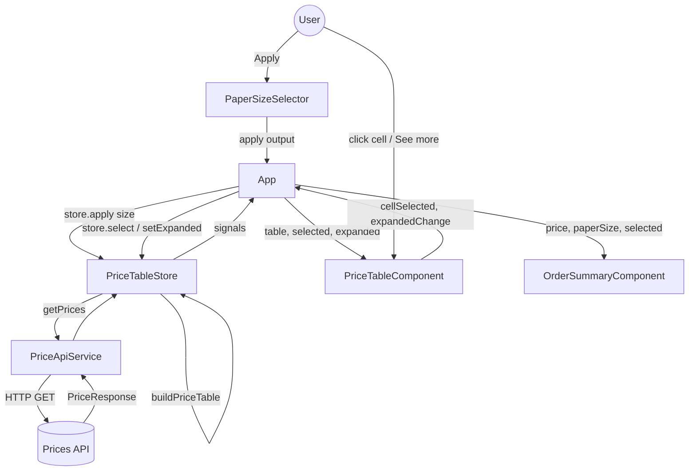
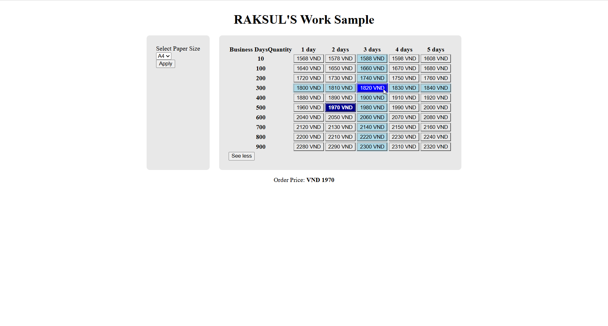
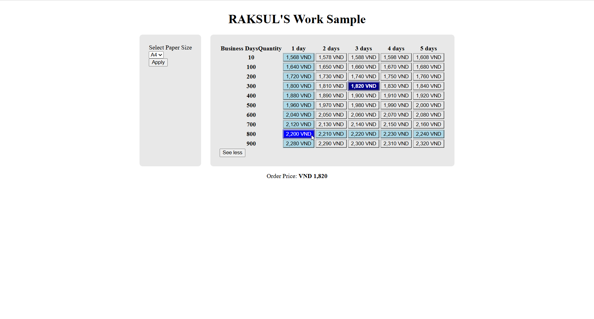

# Price Table

An interactive **price table for paper printing products**. The user picks a paper size and sees every price as a grid of **Quantity × Delivery in business days**. They can then select a price to see it as the order price.

Built with **Angular 22** (standalone components, signals, zoneless change detection) and **no third-party UI, CSS or utility libraries**.

---

## Table of Contents

1. [Features](#1-features)
2. [Tech Stack](#2-tech-stack)
3. [Getting Started](#3-getting-started)
4. [Project Structure](#4-project-structure)
5. [Task 1 – Analysis & Implementation](#5-task-1--analysis--implementation)
6. [Task 2 – Number Formatting](#6-task-2--number-formatting)
7. [Assumptions](#7-assumptions)
8. [Possible Improvements](#8-possible-improvements)

---

## 1. Features

### Task 1-a – Core functionality

| # | Feature | Status |
|---|---|---|
| 1 | Prices displayed in a table of **Quantity (rows) × Delivery in business days (columns)** | ✅ |
| 2 | Paper size selection (A4, A5, B4, B5); the table reloads when **Apply** is clicked | ✅ |

### Task 1-b – Add-on functionality

| # | Feature | Status |
|---|---|---|
| 1 | **Cell selection**: the clicked cell is highlighted and its price is shown as **Order Price** | ✅ |
| 2 | **See more**: 5 quantity rows initially, all rows after clicking "See more" ("See less" collapses again) | ✅ |
| 3 | **Hover**: the hovered cell is highlighted, and the cells in its row and column are weakly highlighted | ✅ |

### Task 2 – Number formatting

| Feature | Status |
|---|---|
| `formatPrice()` inserts a comma every 3 digits without `toLocaleString()` or `Intl.NumberFormat()` | ✅ |
| Every price in the table and the Order Price is displayed with this formatting | ✅ |

### Extras

- **Race-condition safe loading.** Applying a new size cancels the request still in flight (`switchMap`).
- **Per-size response cache.** Switching back to a size already loaded does not call the API again.
- **Loading and error states.** A "Loading prices…" message on the first load, and an error message if the request fails.
- **Keyboard support.** Prices are `<button>` elements, so they can be selected with the keyboard. Focusing a price applies the same highlighting as hovering it.

---

## 2. Tech Stack

### Runtime dependencies

| Package | Version | Purpose |
|---|---|---|
| `@angular/core` | 22.2.2 | Components, signals, dependency injection |
| `@angular/common` | 22.2.2 | `HttpClient`, common utilities |
| `@angular/compiler` | 22.2.2 | Template compiler |
| `@angular/platform-browser` | 22.2.2 | Browser bootstrap |
| `@angular/router` | 22.2.2 | Router (from the project scaffold; no routes are defined) |
| `@angular/forms` | 22.2.2 | Installed by the scaffold; not used by the app |
| `rxjs` | 7.8.2 | Request pipeline (`switchMap` for cancellation) |
| `tslib` | 2.8.1 | TypeScript runtime helpers |

### Development dependencies

| Package | Version | Purpose |
|---|---|---|
| `@angular/cli` | 22.2.2 | `ng` command line |
| `@angular/build` | 22.2.2 | Build system (esbuild + Vite) and unit-test builder |
| `@angular/compiler-cli` | 22.2.2 | Ahead-of-time compilation |
| `typescript` | 6.0.3 | Language |
| `vitest` | 4.1.11 | Unit test runner |
| `jsdom` | 28.1.0 | DOM environment for tests |
| `prettier` | 3.9.9 | Code formatting |

### Angular features used

- Standalone components (no `NgModule`)
- Signals: `signal`, `computed`, `linkedSignal`
- Signal-based component APIs: `input()`, `input.required()`, `output()`
- Built-in control flow: `@if`, `@for`, `@let`
- `inject()` for dependency injection
- `ChangeDetectionStrategy.OnPush` on every component
- Zoneless change detection (the default for new Angular projects; no `zone.js`)

### Compliance with the assignment restrictions

| Restriction | How it is met |
|---|---|
| Use a JavaScript framework | Angular |
| No utility libraries (jQuery, Lodash, …) | Only Angular packages and RxJS, which is a core Angular dependency |
| No CSS frameworks (Bootstrap, …) | Hand-written CSS |
| No UI component libraries (Angular Material, …) | Native `<select>`, `<table>` and `<button>` elements |
| No `toLocaleString()` / `Intl.NumberFormat()` | Custom `formatPrice()` (see [Task 2](#6-task-2--number-formatting)) |
| Latest Chrome / Firefox | Uses only standard modern web APIs |

---

## 3. Getting Started

### Prerequisites

| Tool | Version |
|---|---|
| Node.js | `^22.22.3`, `^24.15.0` or `>=26.0.0` (required by Angular 22) |
| npm | Bundled with Node.js (the project pins `npm@10.9.8`) |

Check your versions:

```bash
node -v
npm -v
```

### Installation

```bash
# 1. Get the source (clone the repository or unzip the archive)
cd raksul-work-sample-table-price

# 2. Install dependencies
npm install
```

### Run locally

```bash
npm start
```

Open **http://localhost:4200**. The app reloads automatically when a source file changes.

The app calls the public API at `https://us-central1-fe-ws-test.cloudfunctions.net/prices`, so an internet connection is required.

### Run the tests

```bash
npm test                     # watch mode
npm test -- --watch=false    # single run (CI)
```

### Production build

```bash
npm run build
```

The output is written to `dist/raksul-work-sample-table-price/browser`. To preview it, serve that folder with any static server, for example:

```bash
npx http-server dist/raksul-work-sample-table-price/browser -p 8080
```

### Available scripts

| Script | Command | Description |
|---|---|---|
| `npm start` | `ng serve` | Development server on port 4200 |
| `npm test` | `ng test` | Unit tests with Vitest |
| `npm run build` | `ng build` | Production build |
| `npm run watch` | `ng build --watch --configuration development` | Rebuild on change |

### Troubleshooting

| Problem | Solution |
|---|---|
| `The Angular CLI requires a minimum Node.js version` | Upgrade Node.js to a version listed in [Prerequisites](#prerequisites) |
| Port 4200 is already in use | `npm start -- --port 4300` |
| The page shows "Could not load prices for …" | Check your internet connection, then click **Apply** again |

---

## 4. Project Structure

```
raksul-work-sample-table-price/
├── README.md
├── angular.json                         # Angular workspace configuration
├── package.json
├── tsconfig.json / tsconfig.app.json / tsconfig.spec.json
└── src/
    ├── index.html
    ├── main.ts                          # bootstraps App
    ├── styles.css                       # global styles
    └── app/
        ├── app.ts|html|css              # page layout; connects the store and the components
        ├── app.config.ts                # providers (HttpClient, Router)
        ├── app.routes.ts                # empty route list (scaffold)
        ├── models/
        │   └── price.model.ts           # types and constants
        ├── services/
        │   ├── apis/
        │   │   └── price-api.service.ts # GET /prices?paper_size=
        │   └── stores/
        │       └── price-table.store.ts # signal state and loading pipeline
        ├── components/
        │   ├── paper-size-selector/     # dropdown + Apply
        │   ├── price-table/             # table, hover, selection, See more
        │   └── order-summary-component/ # Order Price
        ├── pipes/
        │   └── format-price-pipe.ts     # Task 2: template wrapper for formatPrice
        └── utils/
            ├── build-price-table.ts     # API response -> table structure
            └── format-price.ts          # Task 2: comma every 3 digits
```

---

## 5. Task 1 – Analysis & Implementation

### 5.1 Requirement analysis

The specification was broken down into testable requirements. Task 1-a items are ordered by priority, as stated in the assignment. Task 1-b items may be done in any order.

| ID | Requirement | Priority | Acceptance criteria |
|---|---|---|---|
| **R1** | View prices in a table of Delivery in business days × Quantity | Must (1-a #1) | Each cell shows the API price for one (quantity, business day) pair. Quantities are the rows and business days are the columns |
| **R2** | Select paper size and view its table | Must (1-a #2) | A4, A5, B4 and B5 are selectable. Clicking Apply loads and shows that size's prices |
| **R3** | Select a cell | Should (1-b #1) | Clicking a price highlights that cell (and only that cell). Its price appears as "Order Price" |
| **R4** | See more | Should (1-b #2) | 5 quantity rows are shown at first. After "See more", every quantity row is shown |
| **R5** | Hover feedback | Should (1-b #3) | The hovered cell is highlighted. Its row and column are weakly highlighted |
| **C1** | Use a JS framework, with no utility, CSS or UI component libraries | Constraint | Only Angular and RxJS are used at runtime |
| **C2** | Works in the latest Chrome and Firefox | Constraint | Only standard web APIs are used |

**Reading "Delivery in business days × Quantity".** The "×" means "by", as in "a 3 × 4 table". It describes the two dimensions of the table, not a multiplication. Three things confirm this reading:

- The API returns a ready-made `price` for every `(business_day, quantity)` pair.
- Task 1-b #3 asks the user to "check respective delivery in business days and quantity" for a price.
- The wireframe highlights one row and one column that cross at the selected cell.

**Choosing which axis is which.** R4 says the initial display is "5 rows of quantity". So quantities must be the **rows** and business days the **columns**.

### 5.2 Wireframe analysis

```
┌─ Selector panel ─────┐  ┌─ Table panel ─────────────────────────────┐
│ Select paper size    │  │ Price table                               │
│ [ A4            ▼ ]  │  │ ┌──┬──┬──┬──┬──┬──┐                        │
│                      │  │ │  │  │  │░░│  │  │  ░ weak (row/column)   │
│                      │  │ ├──┼──┼──┼──┼──┼──┤  █ strong (cell)       │
│             [Apply]  │  │ │  │░░│░░│██│░░│  │                        │
└──────────────────────┘  └───────────────────────────────────────────┘
┌─ Summary bar ───────────────────────────────────────────────────────┐
│                                      Order price: 9999 VND    [ Cart ]│
└─────────────────────────────────────────────────────────────────────┘
```

| Observation | Design decision |
|---|---|
| Three visually separate regions | Three components: `PaperSizeSelector`, `PriceTableComponent`, `OrderSummaryComponent` |
| The dropdown has a separate **Apply** button | The dropdown edits a local draft. Data is fetched only when Apply is clicked |
| The table has 1 header column + 5 data columns | Matches the 5 business days returned by the API |
| Two highlight intensities (light row/column, dark cell) | Three CSS layers: weak (row/column) → hover (cell) → selected (cell), with the strongest one declared last |

### 5.3 API analysis

**Contract**

```
GET https://us-central1-fe-ws-test.cloudfunctions.net/prices?paper_size=A4
```

| Item | Specification |
|---|---|
| Parameter | `paper_size`: `"A4" \| "A5" \| "B4" \| "B5"`, case-insensitive, default `"A4"` |
| `prices` | Always 10 rows, sorted by increasing quantity |
| Row | Array of `{ business_day, price, quantity }` |

**Observed response** (live call for A4):

| Property | Value |
|---|---|
| Quantities (rows) | 10, 100, 200, 300, 400, 500, 600, 700, 800, 900 |
| Business days (columns) | 1, 2, 3, 4, 5 |
| Response `paper_size` | lowercase (`"a4"`) |

**Spec issues found**

| Issue | Handling |
|---|---|
| `GET /prices?paper_size=(A5\|A5\|B4\|B5)` lists A5 twice and leaves out A4 | Interpreted as `A4 \| A5 \| B4 \| B5`, matching the parameter description |
| The host is written as `//` (protocol-relative) | HTTPS is used explicitly |
| `Content-Type: application/json` on a GET request | Not needed (a GET has no body), so it is not sent |

**Risks and edge cases identified from the data model**

| Risk | Mitigation |
|---|---|
| The number of business days is not documented | Columns are **derived from the data**, not hard-coded |
| A row might be missing a business day | Cells are looked up in a `Map`. A missing cell renders as "—" |
| An item might be malformed | Invalid items are skipped instead of crashing the table |
| The user switches sizes quickly, and responses arrive out of order | `switchMap` cancels the previous request |
| Network or server error | An error message is shown in place of the table |

### 5.4 Resolving ambiguities

When the specification was silent, the simplest behavior consistent with the wireframe was chosen:

| Question | Decision | Reason |
|---|---|---|
| Should changing the dropdown reload the table immediately? | No, only on **Apply** | The wireframe has an explicit Apply button |
| What happens to the selection when the paper size changes? | It is cleared | The selected price belongs to the previous size |
| What happens to "See more" when the paper size changes? | Collapses back to 5 rows | Consistent starting state for every table |
| Can the user collapse the table after "See more"? | Yes, with "See less" | Small addition that improves usability |
| What does "Order Price" show before any selection? | "-" | Avoids showing a misleading 0 |

### 5.5 Architecture

#### Data flow



The data flows **one way**. The store holds the state. Components receive it through `input()` and report user actions through `output()`. Only `App` talks to the store.

#### Layers

| Layer | Files | Responsibility |
|---|---|---|
| Model | `models/price.model.ts` | Types and constants (`PAPER_SIZES`, `PAPER_SIZE_DEFAULT`, `INIT_VISIBLE_ROWS`) |
| Data access | `services/apis/price-api.service.ts` | One HTTP call, no logic |
| Transformation | `utils/build-price-table.ts` | Pure function: API response → table structure |
| State | `services/stores/price-table.store.ts` | Signals, loading pipeline, cache |
| Container | `app.*` | Connects the store to the components; loading and error states |
| Presentation | `components/*` | Rendering and user interaction only |

#### State model

| State | Type | Owner | Why it lives there |
|---|---|---|---|
| `paperSize` | `PaperSize` | Store | Needed by the selector and the order summary |
| `table` | `PriceTable \| null` | Store | Shared data |
| `loading`, `error` | `boolean`, `string \| null` | Store | Set by the loading pipeline |
| `selected` | `CellRef \| null` | Store | Needed by the table (highlight) and the summary (price) |
| `expanded` | `boolean` | Store | Must reset when the paper size changes |
| `selectedPrice` | `computed` | Store | Derived from `table` + `selected` |
| `hovered` | `CellRef \| null` | `PriceTableComponent` | Purely visual. No other component needs it |
| `paperSizeSelected` | `linkedSignal` | `PaperSizeSelector` | Unconfirmed dropdown value |

#### Data model transformation

The API's nested arrays are reshaped into a structure that is easy to render:

```
API response                               PriceTable
──────────────────────────────            ─────────────────────────────────
prices: [                                  quantities:   [10, 100, …, 900]   ← rows
  [ {day 1, qty 10, 1568},        ───►     businessDays: [1, 2, 3, 4, 5]     ← columns
    {day 2, qty 10, 1578}, … ],            cells: Map {
  [ {day 1, qty 100, 1648}, … ],             "10-1"  → 1568,
  …                                          "10-2"  → 1578,
]                                            "100-1" → 1648, …  }
```

The template loops over `quantities`, then over `businessDays`, and looks up each price in O(1) time with `getCellPrice(table, quantity, day)`.

### 5.6 Implementation

Core requirements (R1, R2) were built before any add-on, so a working baseline existed at every point.

#### R1 – Rendering the table

`PriceTableComponent` uses a semantic `<table>`. Business days are the column headers (shown as "1 day", "2 days", …) and quantities are row headers (`<th scope="row">`).

```html
@for (qty of visibleQuantities(); track qty) {
  <tr>
    <th scope="row" class="row-header">{{ qty }}</th>
    @for (day of table().businessDays; track day) {
      @let price = priceOf(qty, day);
      <td class="cell">…{{ price | formatPrice }} VND…</td>
    }
  </tr>
}
```

#### R2 – Paper size selection

The selector keeps a draft value with `linkedSignal`, which resets automatically whenever the applied size changes from outside. Changing the dropdown only updates the draft; submitting the form with **Apply** emits the `apply` output.

The store loads the data through a single RxJS pipeline:

```ts
this.$apply.pipe(
  tap(() => { this.loading.set(true); this.error.set(null); }),
  switchMap((size) => this.fetchTable(size)),   // cancels the previous request
  takeUntilDestroyed(),
).subscribe((table) => {
  this.table.set(table);
  this.selected.set(null);    // reset for the new size
  this.expanded.set(false);
  this.loading.set(false);
});
```

`fetchTable` returns the cached table when one exists. Otherwise it calls the API, maps the response with `buildPriceTable`, stores the result in the cache, and turns HTTP errors into a user-facing message. The default size (A4) is applied in `App.ngOnInit`.

#### R3 – Cell selection

Each price is a `<button>` inside its `<td>`, so it can be focused and selected with the keyboard (Enter/Space) with no extra code. A click emits `cellSelected`, and the store updates `selected`. The order price is a derived value:

```ts
readonly selectedPrice = computed(() => {
  const t = this.table();
  const s = this.selected();
  return t && s ? t.cells.get(`${s.quantity}-${s.businessDay}`) ?? null : null;
});
```

`OrderSummaryComponent` shows "Order Price: VND {price}", or "-" when nothing is selected.

#### R4 – See more

```ts
protected readonly visibleQuantities = computed(() => {
  const quantites = this.table().quantities;
  return this.expanded() ? quantites : quantites.slice(0, INIT_VISIBLE_ROWS);
});
```

The button toggles between "See more" and "See less" and exposes `aria-expanded`. It is hidden when there are 5 rows or fewer.

#### R5 – Hover highlighting

A local `hovered` signal is set on `mouseenter` of a cell and on `focus` of its button, so keyboard users get the same feedback. It is cleared on `blur` of the button. Every cell compares its own coordinates with the hovered one:

```html
<td
  class="cell"
  [class.row--hovered]="hovered()?.quantity === qty"
  [class.col--hovered]="hovered()?.businessDay === day"
  [class.cell-selected]="isSelected(qty, day)"
  [class.cell-hovered]="isHovered(qty, day)"
  (mouseenter)="setHover(qty, day)">
```

The CSS declares the classes from weakest to strongest (`.row--hovered`/`.col--hovered` → `.cell-hovered` → `.cell-selected`), so the selected cell stays visible even while the user hovers over its row.

### 5.7 Edge cases and error handling

| Scenario | Behavior |
|---|---|
| First load still in progress | "Loading prices…" (`role="status"`) |
| Switching sizes while a table is shown | The previous table stays visible until the new data arrives |
| Apply clicked several times quickly | Only the last request is kept (`switchMap`) |
| Size already loaded before | Served from the cache, no HTTP request |
| HTTP error | "Could not load prices for B5. Please try again." in place of the table (`role="alert"`) |
| Missing cell in the response | Rendered as "—", not clickable |
| Malformed item in the response | Skipped |
| 5 rows or fewer | "See more" is hidden |
| Selected row hidden by "See less" | The selection and order price are kept |

### 5.8 Trade-offs

| Decision | Alternative | Why this choice |
|---|---|---|
| Signals + a small store service | NgRx, or another state library | The state is small; an extra library would add boilerplate with no benefit |
| `Map` with string keys | Using `prices[row][col]` directly | Does not depend on the API's ordering; handles missing cells |
| Hover state in signals | CSS-only `:hover` | CSS cannot highlight a whole **column**; signals also support keyboard focus |
| Presentational components | Components that inject the store | Easier to test and reuse; one clear data flow |
| Cache per paper size | Always refetch | Prices are static for this exercise. With live prices, the cache would need an expiry time |
| `<button>` inside each cell | Click handler on the `<td>` | Keyboard support for free |

### 5.9 Result



The screenshot shows the A4 table after clicking "See more" (all 10 quantity rows):

- **Selected cell** (dark blue): 500 pcs, 2 days. Its price is shown as "Order Price: VND 1970".
- **Hovered cell** (blue): 300 pcs, 3 days. The other cells in its row and column are weakly highlighted (light blue).

---

## 6. Task 2 – Number Formatting

### 6.1 Requirement

Display every price with a comma every 3 digits, counted from the right (`1000` → `1,000`, `1234567` → `1,234,567`), **without** using `toLocaleString()` or `Intl.NumberFormat()`. Prices are natural numbers.

### 6.2 Implementation

`src/app/utils/format-price.ts`:

```ts
export function formatPrice(value: number): string {
  if (!Number.isSafeInteger(value) || value < 1) {
    throw new RangeError(`FormatPrice expects a positive integer, received: ${value}`);
  }

  const digits = String(value);
  let rs = '';

  for (let i = 0; i < digits.length; i++) {
    const remaining = digits.length - i;
    rs += digits[i];
    if (remaining > 1 && (remaining - 1) % 3 === 0) {
      rs += ',';
    }
  }
  return rs;
}
```

**How it works.** The number is converted to a string and read from left to right. After each digit, `remaining - 1` is the number of digits still to come. When that number is a non-zero multiple of 3, a comma is added.

Example for `1234567` (7 digits):

| Digit | `1` | `2` | `3` | `4` | `5` | `6` | `7` |
|---|---|---|---|---|---|---|---|
| Digits after it | 6 | 5 | 4 | 3 | 2 | 1 | 0 |
| Comma after it? | ✅ | | | ✅ | | | |

Result: `1,234,567`.

**Input validation.** Anything that is not a natural number is rejected with a `RangeError`: `0`, negative numbers, decimals, `NaN`, `Infinity`, and values above `Number.MAX_SAFE_INTEGER` (beyond that limit, JavaScript can no longer represent every digit exactly).

| Input | Output |
|---|---|
| `1` | `"1"` |
| `999` | `"999"` |
| `1000` | `"1,000"` |
| `1568` | `"1,568"` |
| `1234567` | `"1,234,567"` |
| `0`, `-1`, `1.5`, `NaN` | throws `RangeError` |

### 6.3 Using it in templates

`FormatPricePipe` (`src/app/pipes/format-price-pipe.ts`) wraps the function so templates can use `{{ price | formatPrice }}`. It returns `"-"` for `null`/`undefined` and for values that `formatPrice` rejects, so one bad value cannot break the page.

The pipe is used in two places:

| Where | Template | Example |
|---|---|---|
| Table cell (`PriceTableComponent`) | `{{ price \| formatPrice }} VND` | `1,820 VND` |
| Order Price (`OrderSummaryComponent`) | `VND {{ price() \| formatPrice }}` | `VND 1,820` |

### 6.4 Result



Every price in the table and the Order Price now has a comma every 3 digits (for example `1,820 VND` and "Order Price: VND 1,820").

---

## 7. Assumptions

- The paper size is applied only when **Apply** is clicked, as in the wireframe.
- Changing the paper size clears the selection and collapses the table, because the selected price belongs to the previous size.
- Prices do not change during a session, so caching each size's response is safe.
- Prices are natural numbers, as stated in Task 2, so `formatPrice` does not handle decimals.

---

## 8. Possible Improvements

- **Cart** button in the order summary, as shown in the wireframe.
- Show the selected details next to the order price (e.g. "A4 · 200 pcs · 4 business days").
- Highlight the row and column **headers** on hover, and clear the hover when the mouse leaves the table.
- Dim the previous table while the next one is loading (the `table-area--loading` class is already applied but has no style yet).
- A **Retry** button on the error message.
- Accessibility: `<caption>`, `scope="col"` on column headers, `aria-pressed` on the selected price, `aria-live` on the order price.
- Responsive layout for narrow screens.
- Unit, component and integration tests (currently only the generated "should create" specs exist), including unit tests for `formatPrice` and a check that `toLocaleString()` / `Intl.NumberFormat()` are never called.
- Use the same currency format in the table and the Order Price (`1,820 VND` vs `VND 1,820`).
- Arrow-key navigation between cells (roving `tabindex`).
- Keep the paper size and selection in the URL so they survive a reload and can be shared.
